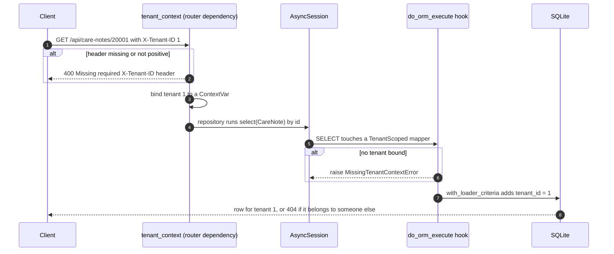
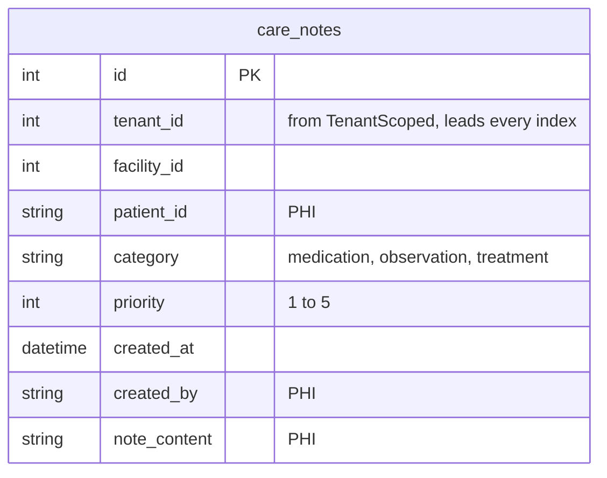

# Care Notes API

A multi-tenant care notes service in FastAPI and SQLAlchemy 2 (async). Several healthcare organisations share one
`care_notes` table, so the design problem is isolation: one forgotten `WHERE tenant_id = ...` and an organisation reads
another's clinical records. No query in this codebase writes that predicate. A SQLAlchemy hook adds it to every read,
and a read issued with no tenant bound raises instead of scanning the table.

## One request, end to end



## Running locally

Python 3.11 or later, no services needed. The default database is a SQLite file in the working directory.

```bash
python -m venv .venv && source .venv/bin/activate
pip install -r requirements-dev.txt
python -m app.seed --count 20000      # explicit; never runs at startup
uvicorn app.main:app --port 8160
```

`docker compose up --build` does the same on port 8160 (seeding is idempotent). Interactive docs live at `/docs`.

Tenant 2 creates a note whose body claims tenant 1. The create schema has no `tenant_id` field, so the header wins:

```console
$ curl -s -X POST localhost:8160/api/care-notes -H 'X-Tenant-ID: 2' -H 'Content-Type: application/json' \
    -d '{"tenant_id":1,"facility_id":21,"patient_id":"P-T2-F21-007","category":"medication",
         "priority":2,"created_by":"nurse.t2","note_content":"SYNTHETIC FIXTURE: 5mg administered."}'
{"id":20001,"tenant_id":2,"facility_id":21,"patient_id":"P-T2-F21-007","category":"medication",...}
```

Tenant 1 cannot read or delete it, tenant 2 still can, and a request with no tenant is rejected:

```console
$ curl -s -w ' HTTP %{http_code}\n' -H 'X-Tenant-ID: 1' localhost:8160/api/care-notes/20001
{"detail":"Care note not found."} HTTP 404
$ curl -s -w ' HTTP %{http_code}\n' -X DELETE -H 'X-Tenant-ID: 1' localhost:8160/api/care-notes/20001
{"detail":"Care note not found."} HTTP 404
$ curl -s -o /dev/null -w 'HTTP %{http_code}\n' -H 'X-Tenant-ID: 2' localhost:8160/api/care-notes/20001
HTTP 200
$ curl -s -w ' HTTP %{http_code}\n' localhost:8160/api/care-notes
{"detail":"Missing required X-Tenant-ID header."} HTTP 400
```

The analytics rollup shows the same boundary. Tenant 1 owns facilities 11 to 14, tenant 2 owns 21 to 24:

```console
$ curl -s -H 'X-Tenant-ID: 1' 'localhost:8160/api/care-stats?range=all_time'
{"tenant_id":1,"total_notes":6672,"unique_patients":100,"avg_notes_per_patient":66.72,
 "by_category":{...},"by_priority":{...},"by_facility":{"11":1682,"12":1674,"13":1692,"14":1624},...}
$ curl -s -H 'X-Tenant-ID: 2' 'localhost:8160/api/care-stats?range=all_time'
{"tenant_id":2,"total_notes":6572, ... ,"by_facility":{"21":1655,"22":1603,"23":1641,"24":1673}, ...}
```

## Architecture

Routers, services, repositories, models, with dependencies pointing inward. Cross-cutting concerns live in `app/core`
and every SQL statement is in `app/repositories/care_notes.py`. Start reading at `app/core/tenancy.py`.

| Endpoint | Purpose |
|---|---|
| `GET /api/care-notes` | Paginated list, optional `facility_ids=11,12` filter |
| `POST /api/care-notes` | Create (201) |
| `GET / PUT / DELETE /api/care-notes/{id}` | Read, partial update, delete (204) |
| `GET /api/care-stats` | Rollup by facility, category and priority over `range` or `start_date`/`end_date` |
| `GET /health`, `GET /ready` | Liveness, and readiness with a database check |



`facility_id` and `patient_id` are plain identifiers with no tables behind them. Every access path starts with a tenant,
so `tenant_id` leads all three indexes: `(tenant_id, created_at)` for listing, `(tenant_id, facility_id, created_at)` for
the rollup, `(tenant_id, patient_id, created_at)` for patient history.

## Design decisions

**Scoping in an ORM hook instead of in each query.** `CareNote` inherits `TenantScoped`. A `do_orm_execute` listener
appends the predicate with `with_loader_criteria` to any SELECT touching a `TenantScoped` mapper, reading the tenant from
a `ContextVar` bound by a router-level dependency. The guarantee now rests on SQLAlchemy behaviour, so tests pin it:
`test_aggregates_are_scoped_too` covers `count()` and `GROUP BY` selects (which would otherwise leak totals), and
`test_scope_switches_cleanly_between_tenants` alternates tenants to prove no tenant id gets baked into SQLAlchemy's
compiled statement cache. Leaving the scope takes `unscoped()`, so `grep -rn unscoped app/ scripts/` lists every place the
guarantee is suspended: the seeder and the benchmark.

**Writes are guarded separately.** The hook sees only SELECTs. Creates take the tenant from context, and `DELETE` first
resolves the row through the scoped `get()`. Cross-tenant ids get 404, since a 403 would confirm the id exists.

**Isolation is not authentication.** The tenant comes from a client-supplied `X-Tenant-ID` header that anyone can set.
The machinery above stops a *bug* from crossing tenants; it does nothing about a *caller* who claims to be tenant 2.
Before real data, that header must become a verified JWT claim. Everything downstream reads the tenant from context, so
that is a one-dependency change in `app/api/deps.py`. It has not been made.

**One `GROUP BY` for analytics.** `/api/care-stats` runs one `GROUP BY facility_id, category, priority` and folds the rows
in Python, so the result is bounded by facilities x categories x priorities at any volume. Distinct patients need a
second query; `test_rollup_issues_one_query_per_dimension_set` counts statements so this cannot regress. Windows are
half-open (`start <= created_at < end`) range comparisons, which keep the index usable.

**The cache is a seam.** `AnalyticsService` depends on the `AnalyticsCache` protocol in `app/core/cache.py`, with
`NullCache` and an LRU-bounded `InMemoryTTLCache` behind it. In-process suits one container; several replicas would want
Redis, which is one new class and one line in `build_cache()`. Keys come only from `stats_cache_key()`, tenant id first,
and `test_analytics_cache_does_not_leak_between_tenants` asserts two tenants asking the same question get two entries.

## Clinical data handling

Seed and fixture data is visibly synthetic (`P-T1-F11-001`, bodies starting `SYNTHETIC FIXTURE`), asserted by
`tests/test_seed.py`. The three PHI columns are never logged and `CareNote.__repr__` omits them, since reprs land in
tracebacks. A 500 returns only `"Internal server error."`. `tests/test_phi_safety.py` runs the read paths at `DEBUG` and
checks no patient identifier or note body reaches a log or an error response.

## Configuration

Read by `app/config.py`; every value has a default, and `.env.example` lists them all.

| Variable | Default | Effect |
|---|---|---|
| `DATABASE_URL` | `sqlite+aiosqlite:///./carenotes.db` | Async SQLAlchemy URL |
| `MAX_PAGE_SIZE` | `100` | Larger `page_size` values are clamped, so `?page_size=100000` returns 100 |
| `ANALYTICS_CACHE_TTL_SECONDS` | `30` | `0` selects `NullCache` |
| `ANALYTICS_CACHE_MAX_ENTRIES` | `512` | LRU bound (keys include client-supplied dates) |
| `SEED_*` | see `.env.example` | Size of the dataset `python -m app.seed` builds |

## Testing

`pytest` runs 86 tests against in-memory SQLite in about a second: tenant isolation 21, analytics 26, CRUD and
validation 26, seeding 5, probes 4, PHI containment 4. `ruff check .` is clean. `python -m scripts.benchmark` runs the
rollup against a load-and-count-in-Python baseline over the same window and only prints timings once both agree. On 20,000 seeded rows (6,668 in the window) the rollup came out about 2.5x faster.

## Limitations and roadmap

- **Authentication.** Swap the header for a verified JWT claim. This blocks any real deployment.
- **Authorisation and audit.** Any tenant 1 caller can change every tenant 1 note. Roles, an access log, rate limits.
- **Postgres and migrations.** Only SQLite has been run, and `create_all` owns the schema. Next: `asyncpg` and Alembic.
- **Keyset pagination.** Offset paging walks skipped rows; `(created_at, id)` keysets fit the existing index.
- **Cache invalidation.** Per process and TTL only: a new note can lag in stats by `ANALYTICS_CACHE_TTL_SECONDS`.
- **Soft deletes.** `DELETE` is permanent, which a clinical record system rarely wants.
